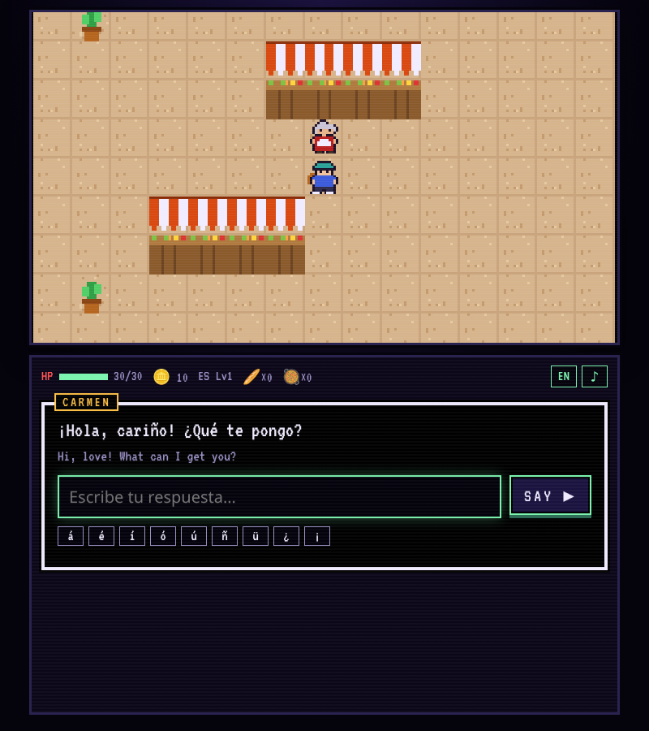
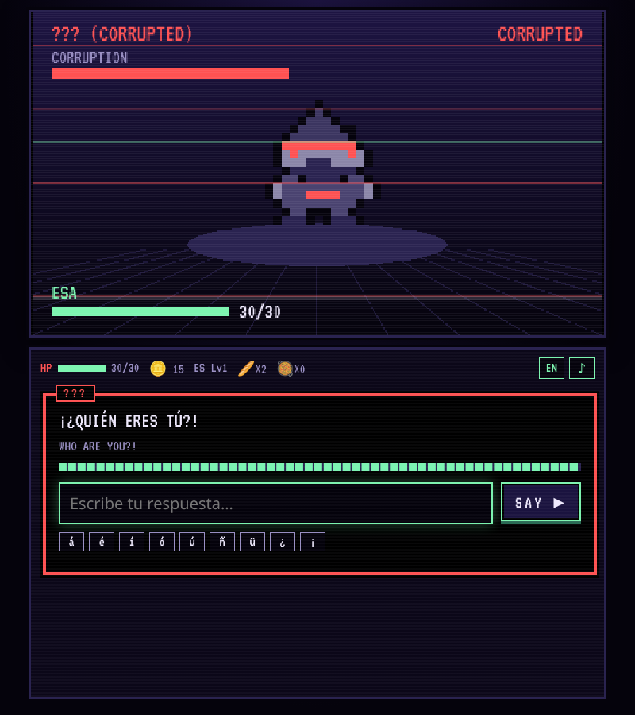
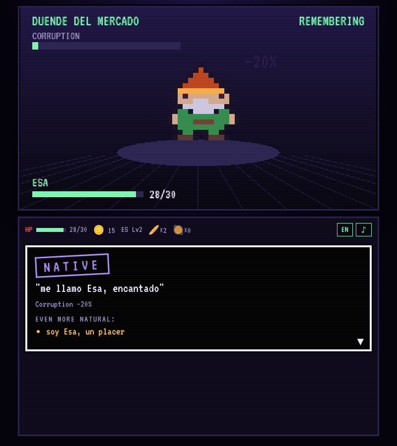
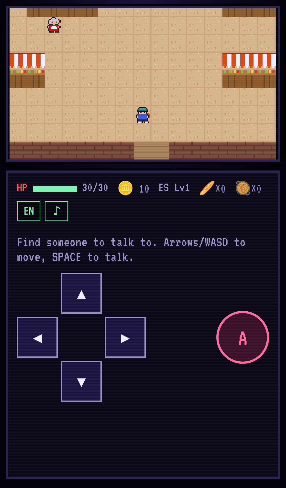

# Zaban

*Zaban* means "language" or "tongue" in Persian, Urdu and Hindi.

A language-learning RPG for polyglots. A virus called ANTI has broken into OMNI, the
world's translation AI, erased English and started rewriting every language. Live
through each country, restore its corrupted legends by speaking to them, and become
the living backup ANTI can't delete. Casual modes (Daily Climb, Tower, Bridge Rush,
Duels) and a story mode share one profile.

## Prototype

- **Title screen:** Story Mode, Casual Modes (coming soon), Log in / Profile.
- **Story Mode opening:** a voice in the dark; you wake on the floor of an airport gate,
  under a departures board melting into ANTI; a stranger asks if you're okay in four
  languages; you sit up among hundreds of stranded passengers; OMNI calls from your pocket and explains everything in an
  illustrated flashback; you give your name.
- **Choosing a country:** a departures board. Only Madrid is open for now; OMNI warns that
  once you land, the borders lock until you free that country.
- **Spain, Act 1 (Mercado de la Luz):** a full market with eight stalls, Spanish signs, a
  fountain plaza, and stallholders and passers-by to chat with; Carmen's "first order"
  life event; the corrupted duende legend battle.
- **Free conversations:** chat with any stallholder about anything, in Spanish. They reply
  in character and recast your mistakes; OMNI adds short corrections; daily/monthly limits
  per plan (Claude via `/api`, demo replies without a key).
- **Smarter battles:** OMNI coaches every line with a goal; replies not on the answer list
  are rated by Claude with a shared rubric (Faint / Clear / Natural / Local).
- **The phone (📱 or P):** OMNI's home screen with Signal, past Chats, a Phrasebook of
  everything you've learnt, Contacts (ask people for their number in Spanish; not everyone
  says yes), Legends, Bag and a map of Madrid that grows as OMNI reclaims relays. CALL a
  contact once per battle for help.
- **Signal energy:** conversations cost one bar each and refill over time (Free / Basic /
  Premium). Story and battles are always free.
- **Accounts:** sign in with Google, Apple, Facebook or Discord (Supabase) to save progress
  to the cloud; guests save on the device. See `docs/setup.md`.

```bash
npm install
npm run dev      # http://localhost:5173
npm test         # grader, sprite and content tests
npm run build    # static build in dist/
```

Controls: arrows/WASD to move, SPACE/ENTER to talk and advance; on phones, the d-pad
and A button. Type answers in Spanish (accent buttons included; accents are optional).
The EN chip toggles English subtitles.

| Quest | Battle (corrupted) | Battle (remembering) | Phone |
| --- | --- | --- | --- |
|  |  |  |  |

### How it's built

- `src/engine/`: the speaking engine shared by every mode. Normalises answers (case,
  accents, punctuation, leading fillers, one typo), matches them against curated lists
  with slots like `{name}` / `{food}`, and ranks them in six tiers from Phrasebook to
  Polyglot. An AI fallback for unlisted answers comes later.
- `src/content/spain/act1.ts`: all script, prompts and accepted answers for the slice.
  `content.test.ts` checks every listed answer is actually accepted.
- `src/scenes/`: Phaser 3 scenes (title, overworld, battle). The battle uses a
  corruption bar and three phases: Corrupted → Wavering → Remembering.
- `src/ui/panel.ts`: the bottom screen (DS-style): typewriter dialogue boxes, menus,
  the answer box with a timer, result stamps, d-pad. Plain DOM for crisp text and
  phone keyboards.
- `src/art/`: original placeholder pixel art drawn from text grids; no asset files.

## Docs

- `docs/game-so-far.md`: everything built so far, and the questions a story must answer
- `docs/story-and-world.md`: lore, why legends attack, country stories, life events, ending
- `docs/gamification.md`: casual vs story mode, battles, food, coins, progression, build order
- `docs/setup.md`: deploying on Vercel and turning on log-in (Supabase + providers)
- `docs/ai-integration.md`: how Claude grades answers, voices characters, and plan limits
- `docs/roadmap-30-languages.md`: what it takes to reach 30 countries at B2
- `docs/monetisation.md`: proposal for energy (OMNI's signal), tiers and payments
- `docs/characters.md`: every character's card (generated from `src/content/characters.ts`)
- `docs/polyglot-game-design.md`: daily round, rarity tiers and grading
- `research/krillion/`: teardown of Krillion (the inspiration) plus a style demo
